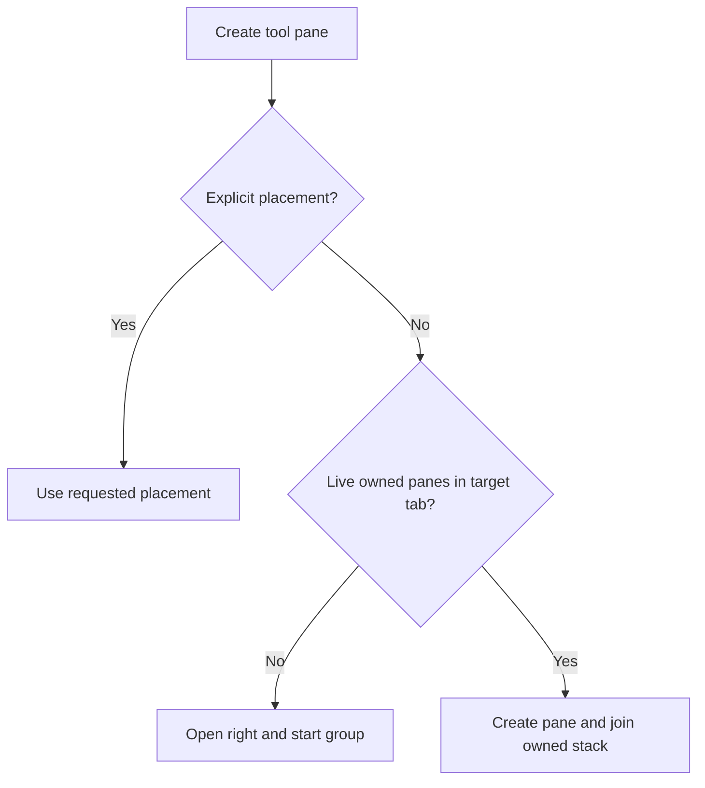

# Extensions

Put TypeScript extensions here, for example:

- custom tools
- commands like `/foo`
- event hooks
- UI widgets or overlays
- custom providers
- safety checks or permission gates

Typical files:
- `my-extension.ts`
- `my-extension/index.ts`

Current local extensions include:
- `daily-work-log.ts` — appends one JSONL record per non-extension user input to `~/.pi/agent/logs/YYYY-MM-DD.jsonl`
- `notify-done.ts` — sends Omarchy completion notifications on Linux, with click-to-focus for the owning Kitty/Zellij session and pane
- `session-title.ts` — auto-generates an untitled new session's display name after the first prompt using `openai-codex/gpt-6-luna`
- `model-harpoon.ts` — opens a model picker on Alt+M
- `thinking-harpoon.ts` — opens a descending thinking-level picker on Alt+T
- `zellij.ts` opens tabs and panes, reads pane output, and sends pane input. Pane creation defaults to the tab containing Pi's `ZELLIJ_PANE_ID`, regardless of the user's focused tab. An explicit `tabId` overrides this default.

## Zellij pane targeting

`zellij_new_pane` and the pane commands `/zl`, `/zj`, `/zf`, `/nvim`, `/gd`, `/zfork`, and `/zreview` look up Pi's owning tab before creating a pane. The lookup follows Pi's pane if it moves to another tab and needs no persisted startup state. If the lookup fails, creation stops rather than falling back to the user's focused tab.

The installed Zellij 0.44.3 build returned a pane ID without creating a pane during an isolated `--near-current-pane` check. This extension uses `list-panes --json --all` and explicit `--tab-id` targeting instead.

`zellij_new_pane` accepts `noFocus: true` to restore the user's previously focused pane and tab after creation and stacking. The default is false; slash commands keep their existing focus behavior. Zellij 0.44.3 has no native `--no-focus`, so focus may briefly change. Capture and restoration run inside the creation queue, including cleanup on failure or cancellation. Capture failures stop creation; restoration failures report any created pane ID so callers can inspect it rather than launch a duplicate.

## Automatic tool pane stacks

When `zellij_new_pane` has no `direction`, `floating`, or `stacked` placement, its first pane opens to the right. Later default calls join that Pi session's stack using explicit pane IDs. Groups are separate for each target tab. Explicit placement bypasses grouping, and the slash commands retain their requested placement.



Creation calls run sequentially within each Pi instance. Before each default creation, the tool removes closed, moved, floating, and suppressed panes from that tab's group. If no members remain, it starts fresh on the right. If stacking fails after creation, the result includes the created pane ID and tells the agent not to recreate it.

Tool results record group ownership for `/reload` recovery in the same Pi process and session. A new process or session cannot adopt those groups. Reload reads all session entries because tree navigation does not undo physical panes.

Run the regression tests with Node's TypeScript stripping support:

```sh
node --test pi/.pi/agent/extensions/zellij.test.mjs
```

The opt-in integration test needs Zellij and util-linux `script`. It creates and cleans up an isolated session, checking stack geometry, focus restoration in the same and unrelated tabs, reload, closed panes, and concurrent creation:

```sh
PI_ZELLIJ_INTEGRATION_TEST=1 node --test pi/.pi/agent/extensions/zellij.integration.test.mjs
```

## Nushell tool results

Run the result-contract regression tests with Node's TypeScript stripping support:

```sh
node --test pi/.pi/agent/extensions/nushell.test.mjs
```

These tests mock process execution; they run no shell commands or model requests.
