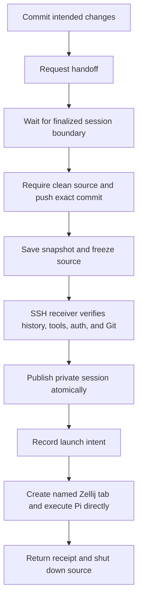

# Move a Pi session between machines

`session-handoff` pushes committed code and transfers the existing conversation over SSH, then starts Pi directly in a named Zellij tab. The default target is `homelab`. Use the same workflow to return.

This is an explicit move, not background sync. Keep exactly one continuation active. The extension freezes source input and tool execution before transport and requests orderly source shutdown after launch confirmation. This is a local guard, not distributed exclusion. It cannot stop a second Pi started without the extension, external file edits, another host, or work already running in another process.

## Setup

Both machines need Pi 1.0.3 or a compatible lifecycle API, Node.js, Git with `--path-format=absolute`, Zellij with `attach --create-background` and JSON tab listing, and the same `session-handoff/` extension files. These APIs were tested with Pi 1.0.3 and Zellij 0.44.3. Install durable dotfiles through the normal Stow workflow on each machine. Do not run `install` from a temporary worktree just to test this feature.

SSH must work non-interactively from the source. Existing SSH configuration supplies users, keys, ports, and Tailscale host aliases. Probe it without changing anything:

```sh
ssh -o BatchMode=yes christian@homelab 'node --version; pi --version; git --version; zellij --version'
```

Executables must be available to the SSH login environment. Fix its PATH or configure explicit executable paths below. Pi credentials stay on each machine. The receiver runs `pi auth check --model provider/id` without requesting or displaying credentials. That checks credential availability, not a successful paid inference. It may refresh expired OAuth credentials. Repository fetch access must also work non-interactively on the destination.

Create `~/.pi/agent/handoff.json` on the source, outside Git:

```json
{
  "targets": {
    "homelab": {
      "host": "christian@homelab",
      "repo": "/home/christian/repos/my-project.git",
      "worktree": "/home/christian/worktrees/my-project-feature",
      "zellijSession": "pi-work",
      "environment": "Linux homelab. No desktop services. Check dependencies before running tests."
    }
  }
}
```

Use your actual user and absolute destination paths, not the example values. `repo` can be an existing checkout or bare repository. If absent, the receiver clones a bare repository there. If `worktree` is absent, it adds one for the working branch. An existing worktree must belong to that repository, be on the same branch, and be clean. Updates are fast-forward only. An existing branch without a worktree must already equal the pushed commit; reconcile it manually otherwise.

Optional target keys:

- `node`, `pi`, `zellij` select executables in the SSH environment. `node` must be a simple executable name or absolute path without spaces, quotes, or shell syntax. The others are passed directly as process arguments.
- `extension` selects the absolute destination directory containing `core.mjs` and `index.ts`. By default it is `~/.pi/agent/extensions/session-handoff`, using the destination's HOME. The receiver checks both file hashes and passes the extension explicitly to Pi. Normal discovery of the same file is deduplicated by Pi.
- `zellijSession` defaults to `pi-work`.
- `environment` adds machine-specific guidance to the resumption message.

Configuration has no implicit username, HOME, or same-path assumption. For multiple projects or branches, create distinct target names with their own worktree paths. Set `PI_CODING_AGENT_DIR` consistently in Pi and the SSH login environment if you use a non-default agent directory.

## Send work to homelab

Start Pi at the worktree root. Ask the agent to commit only the intended changes, then call `session_handoff` with `target: "homelab"`. The tool does not stage or commit anything. It refuses a dirty worktree, pushes the current branch to `origin`, and verifies the exact remote commit. Detached HEAD is not supported. Repository origin URLs must match exactly on both machines.

You can also commit first and run the user command while Pi is idle:

```text
/handoff
/handoff another-target
```

The tool queues its request until `agent_settled`. The command requires an idle session with no queued messages. Neither copies a running tool call. The snapshot comes from finalized `getHeader()`, `getEntries()`, and `getLeafId()` state, not a timed read of a session file. It retains the whole tree and adds a non-context custom entry whose parent is the selected leaf. That entry makes `pi --session` reopen the selected branch even if `/tree` had selected an older branch.

Only the new snapshot header's `cwd` changes. Historical messages, system prompt deltas, compactions, tool paths, and extension state remain intact. Pi rebuilds current workspace context when resuming. The startup message names both machines, directories, branch, exact commit, and environment differences. Old absolute paths are history, not instructions to keep using them.



The receipt identifies the destination host, Zellij session, tab ID, session path, branch, and commit. Attach from a terminal:

```sh
ssh -t christian@homelab zellij attach pi-work
```

A receipt confirms Zellij accepted the launch, not that Pi authenticated to the model, finished a task, or exited. Inspect its tab if startup fails. Reopening an existing container is separate from launching Pi.

## Return work

On homelab, configure a target such as `laptop` in its own `handoff.json`, with the laptop's SSH alias, repository, and worktree paths. Commit the remote work, then use:

```text
/handoff laptop
```

The receiver checks that incoming history includes its previous frozen snapshot and selected branch. It rejects an independently advanced destination session or any active destination that was not handed off. The original checkout may fast-forward to the pushed commit. Continue the returned `active.jsonl`, not the old pre-handoff source file.

### If homelab cannot SSH back

Reverse SSH is not assumed. Still configure the `laptop` target on homelab with the correct laptop paths. Request `/handoff laptop`. After push and snapshot preparation, the SSH failure leaves homelab frozen and prints the transfer ID. Stop that source Pi with `/quit` and verify no other process is continuing it.

From the laptop, pull that frozen transfer using the laptop's existing `homelab` SSH target:

```sh
node ~/.pi/agent/extensions/session-handoff/pull.mjs homelab TRANSFER_ID
```

This retrieves the recorded frozen bundle over SSH, checks that it is still the source's current outgoing transfer and that its transcript has not advanced, then uses the same local receiver and launch records. It does not copy a live session or bypass Git, history, checksum, or retry checks. Run it only on the intended receiving machine; the bundle's destination paths control where it writes and launches. A failed push creates no frozen bundle, so there is nothing to pull.

## Retry and recovery

Runtime data lives under `~/.pi/agent/handoffs/`, or the configured agent directory. It contains full transcripts and may contain sensitive tool output. Keep it out of Git and shared folders. Files use mode 0600 and newly created directories use 0700.

- `outgoing/ID.json` retains the manifest and immutable recoverable snapshot.
- `sources/HASH.json` records `frozen` outgoing ownership or `received` ownership. The hash identifies the session ID.
- `incoming/ID.json` records `prepared`, `launching`, or `launched` and destination identifiers. `prepared` permits retry after publication or container-creation failure, but never overwrites independently advanced history.
- `sessions/HASH/active.jsonl` is the destination's mutable conversation file.
- `locks/HASH/owner.json` identifies an in-progress session or repository operation.

After a transfer failure, do not ask the frozen source agent to continue work. Fix SSH, PATH, authentication, repository state, or extension-version mismatch outside that session, then run:

```text
/handoff retry
```

A retry sends the same ID and snapshot. It never recopies a destination that already acknowledged this transfer, even if that session has since advanced. If SSH loses the launch response, the receiver reconciles the stable `handoff-ID` tab name. If it finds no tab, it leaves the outcome uncertain and refuses another launch. A closed or renamed tab is not proof that Pi never started.

The guard survives `/reload` and restarting Pi with the source session. Slash commands remain available to retry or quit. Source changes before a successful push leave it unfrozen. Failures after the durable freeze keep it frozen, even if no destination process started. No automatic retry or automatic release occurs.

For an uncertain launch or stale lock:

1. Keep both continuations stopped. Inspect the destination receipt, `zellij --session pi-work action list-tabs --json`, panes, and running processes.
2. If the named tab exists, retry the original transfer to reconcile it. Do not create a replacement transfer ID.
3. If a lock remains after a killed helper, verify the recorded owner process is gone before removing only that lock directory. Do not delete an active process's lock.
4. If launch intent exists but no tab can be found, establish whether Pi ever started and whether its session advanced. Preserve the receipt and snapshot before any manual recovery. Never clear intent merely because SSH timed out.

To abandon a handoff and resume locally, first confirm the destination has no running continuation and no new session entries. Stop the frozen source process, archive its source guard and outgoing record, and only then remove its frozen source guard and restart the original session. If launch intent exists, preserve it; do not resend that abandoned transfer. If either side advanced, reconcile code and conversation explicitly instead of deleting ownership records. There is deliberately no agent-callable force/unfreeze operation.

The files use atomic rename for publication, not a disk-fsync transaction. Machine power loss can require manual recovery. Locks fail closed after process death. No process, worktree, branch, receipt, or session gets automatically reset, force-pushed, or deleted to make a retry succeed.

## What does not transfer

Credentials, environment variables, dependencies, uncommitted or ignored files, files outside Git, running servers, terminal contents, and background processes stay machine-local. The transcript retains references to those things, including extension-specific state that may not make sense on another machine. Install the needed extensions and tools separately. Never transfer `auth.json` as part of a handoff.

## Validation

From the dotfiles root:

```sh
node --test pi/.pi/agent/extensions/session-handoff.test.mjs
PI_HANDOFF_INTEGRATION_TEST=1 node --test pi/.pi/agent/extensions/session-handoff.integration.test.mjs
```

The focused suite uses disposable Git repositories and a bare remote, with mocked Pi and Zellij execution for failure injection. It covers failed push, dirty worktrees, repository mismatch, diverged code, missing tools/auth, corrupted transfers, advanced history, retries, lost launch and SSH acknowledgments, quoting, concurrency, pull, and reverse transfer.

The opt-in integration uses the real Pi lifecycle with an offline provider that calls the handoff tool, the shipping SSH command encoder through a local SSH adapter, disposable Git repositories, and a real isolated background Zellij session. The destination executable is a fixture that records arguments and stays alive, not a paid model. It checks the final tool result in the snapshot, private file permissions, the destination cwd and prompt, and one named tab after replay. Another real Pi process reopens a snapshot with an alternate branch and proves the selected branch reaches model context. A restarted frozen source cannot append input. The fixture also exercises the pull CLI. It does not prove real Tailscale connectivity, remote authentication, or remote model availability.
